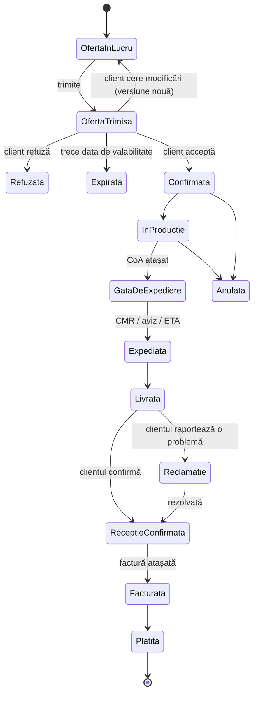

# BIOCETAN — Platforma pentru clienți (portal B2B): plan

> Status: **plan, nimic construit încă** · 2026-10-13 · completează [`IMPLEMENTATION_PLAN.md`](IMPLEMENTATION_PLAN.md) (site-ul public)

## 0. Pe scurt

O platformă privată, legată de site, unde **voi (adminii) creați conturi pentru firmele-client**, discutați cu ele prin **chat**, le trimiteți **oferte**, iar o ofertă acceptată devine **comandă** urmărită pas cu pas: **confirmare → producție → expediere → livrare → recepție confirmată de client → factură → plată → închisă**. Fiecare pas lasă urme: cine, când, ce documente.

Deciziile luate (2026-10-13):

| Decizie                 | Ales                                               | Ce înseamnă                                                                                                                                                                                                            |
| ----------------------- | -------------------------------------------------- | ---------------------------------------------------------------------------------------------------------------------------------------------------------------------------------------------------------------------- |
| Construim sau cumpărăm? | **Platformă proprie**                              | Același stack ca site-ul (Astro + Cloudflare). Urmează exact fluxul vostru, cost lunar aproape zero, o întreținem noi.                                                                                                 |
| Semnarea contractului   | **Contract-cadru o dată + acceptare în platformă** | Contractul-cadru se semnează o singură dată (olograf sau electronic) și se urcă în platformă. Fiecare comandă se acceptă cu un click, iar platforma păstrează dovada: cine, când, IP, versiunea exactă a documentului. |
| Cine lucrează ca admin  | **Tu și șeful**                                    | Un singur rol de admin, cu acces complet. Baza de date are totuși un câmp de rol, ca rolurile pe departamente să poată fi adăugate ulterior fără restructurare.                                                        |
| Facturi și plăți        | **Doar urmărite**                                  | Facturați ca acum (programul vostru + e-Factura). Atașați factura în platformă și marcați plata; clientul vede statusul.                                                                                               |

**Estimare brută: ~8–9 săptămâni de dezvoltare** până la prima versiune lansabilă (§8), fără timpul de răspuns al vostru, al avocatului sau al clienților. **Cost lunar estimat: ~5–25 €** (§6.4).

---

## 1. Fluxul complet, pe exemplul celor 1000 L

Un client nou, „Agro SRL", vrea 1000 L de Agro Carrier în IBC.

1. **Cont.** Creezi firma „Agro SRL" (CUI, adrese de livrare) și o inviți pe Maria, persoana de contact. Maria primește un email cu un link (valabil 72 h), își setează parola și intră în portal.
2. **Cerere.** Maria deschide o cerere: „Agro Carrier, 1000 L, IBC, livrare în noiembrie". Cererea creează automat o conversație.
3. **Discuție.** În chat, Maria cere fișa tehnică. O atașezi (TDS); discutați despre specificație.
4. **Ofertă v1.** Creezi oferta `OF-2026-014`: 1000 L Agro Carrier, IBC 1000 L, X €/L, EXW Săcueni, plată la 30 de zile, valabilă 14 zile. Platforma generează PDF-ul, iar Maria primește email.
5. **Negociere.** Maria cere livrare DAP la ferma ei. Faci **v2** cu transport inclus; v1 rămâne în istoric.
6. **Acceptare.** Maria apasă „Accept", bifează „Am citit și accept Condițiile generale de vânzare v1.2" și își confirmă numele. Platforma salvează dovada (utilizator, dată și oră, IP, amprenta digitală a PDF-ului acceptat).
7. **Comandă.** Se creează automat comanda `CMD-2026-009`, cu PDF de confirmare, și sunteți anunțați amândoi.
8. **Producție → gata de expediere.** Schimbi statusul și atașezi certificatul de analiză (CoA).
9. **Expediere.** Marchezi „Expediată" cu transportatorul, numărul camionului, data estimată (ETA), CMR-ul și avizul. Maria primește email și vede totul pe linia de timp.
10. **Livrare și recepție.** Maria confirmă în portal: „Primit 1000 L, conform", sau raportează o problemă (cantitate lipsă, ambalaj deteriorat, cu poze). O problemă deschide o reclamație.
11. **Factură.** Atașezi factura emisă din programul vostru (număr, sumă, scadență). Maria o vede și o poate descărca.
12. **Plată → închis.** Marchezi factura „Plătită", iar comanda se închide. Dacă trece scadența, platforma îți arată factura ca restantă (și, opțional, îi trimite Mariei un memento).

Fiecare pas apare pe **linia de timp a comenzii** (ca la curier), vizibilă clientului, și în **jurnalul de audit**, vizibil doar adminilor.

---

## 2. Ce vede fiecare

### 2.1 Clientul

- **Autentificare**: invitație pe email → setare parolă → login; resetare parolă; 2FA opțional.
- **Acasă**: oferte care așteaptă răspuns, comenzi în curs (cu pasul curent), mesaje necitite, facturi de plătit.
- **Cerere nouă**: produs, cantitate, ambalaj, locație și dată de livrare, atașamente.
- **Chat cu BIOCETAN**: aproape în timp real, cu atașamente (specificații, poze) și confirmare de citire.
- **Oferte**: vizualizare și PDF; **Accept / Cer modificări / Refuz**.
- **Comenzi**: linia de timp, documente (confirmare, CoA, SDS, CMR, aviz, factură), **confirmare de recepție** sau raportare problemă.
- **Firma mea**: date firmă, adrese de livrare, utilizatori (doar vizualizare în v1).
- **Limbă**: RO / EN.

### 2.2 Adminul (tu și șeful)

- **Panou de control**: cereri noi, oferte în așteptare, comenzi pe statusuri, livrări din săptămâna curentă, mesaje necitite, facturi restante.
- **Clienți**: creare firmă, invitare și dezactivare utilizatori, tot istoricul per client, **note interne** (nevizibile clientului).
- **Inbox chat**: toate conversațiile, necitite primele.
- **Oferte**: construite din catalogul de produse, previzualizare PDF, trimitere, versiuni, duplicare.
- **Comenzi și livrări**: listă/panou pe statusuri; schimbarea unui status cu notă și document notifică automat clientul. O comandă poate avea **mai multe livrări** (ex. 20 t împărțite în 3 transporturi).
- **Documente**: bibliotecă per client (contract-cadru, CoA, SDS, facturi), cu opțiunea „vizibil clientului: da/nu".
- **Facturi**: atașare, scadență, marcare plătită, restanțe.
- **Lead-uri din site**: cererile trimise prin formularul de pe site apar aici și pot fi transformate în client cu un click.

---

## 3. Statusurile comenzii

- Statusurile de producție și livrare sunt **per livrare** (o comandă poate avea mai multe); comanda e „Livrată" când toate livrările sunt confirmate.
- Fiecare tranziție: cine, când, notă opțională, documente atașate, email automat către partea cealaltă.
- Adminul poate corecta un status greșit, dar corecția rămâne în jurnalul de audit (nimic nu se șterge).

---

## 4. Contractul și valoarea juridică

- **Contract-cadru** (o dată per client): stare „Lipsă / Trimis / Semnat", PDF-ul semnat urcat în platformă, perioada de valabilitate.
- **Condiții generale de vânzare** (CGV): document versionat (v1.0, v1.1…). La acceptarea unei oferte, clientul acceptă explicit versiunea curentă.
- **Dovada acceptării**: utilizator, dată și oră (UTC), IP, browser, **amprenta SHA-256 a PDF-ului exact acceptat** și versiunea CGV. Toate se păstrează imutabil.
- **Clienți fără contract-cadru**: setare la alegerea voastră. Fie nu pot accepta oferte până nu e semnat contractul-cadru, fie pot accepta pe baza CGV. **Recomandare**: CGV obligatorii la orice acceptare, plus contract-cadru pentru clienții recurenți.

> ⚠️ **Necesită avocat.** Textul CGV, modelul de contract-cadru și formularea de la acceptare trebuie redactate sau validate de un avocat. Acceptarea electronică simplă e folosită frecvent în B2B, dar nu sunt avocat și nu pot garanta valabilitatea juridică pentru cazul vostru. Platforma doar captează dovezile cât mai solid.

---

## 5. Baza de date (model simplificat)

| Tabel                       | Ce ține                                                                                                                                                  |
| --------------------------- | -------------------------------------------------------------------------------------------------------------------------------------------------------- |
| `companies`                 | Firmele-client: nume, CUI/VAT, Reg. Com., țară, status, contract-cadru (status, valabilitate)                                                            |
| `addresses`                 | Adresele de facturare și livrare per firmă, cu persoană de contact                                                                                       |
| `users`                     | Admini și utilizatori-client: email, nume, telefon, limbă, `role` (`admin`/`client`), status (invitat/activ/dezactivat)                                  |
| `auth_tokens`, `sessions`   | Invitații și resetări de parolă (stocate doar ca hash, cu expirare); sesiuni de login                                                                    |
| `products`                  | Catalog intern: RME, SFME, SME, produsele formulate, servicii; nume RO/EN, unitate, ambalaje posibile                                                    |
| `requests`                  | Cereri (din portal sau din formularul site-ului): produs, cantitate, status                                                                              |
| `conversations`, `messages` | Chat per client, opțional legat de o cerere sau comandă; atașamente; marcaj de citire per utilizator                                                     |
| `offers`, `offer_lines`     | Oferte versionate: monedă, Incoterm, termen de plată, valabilitate, linii (produs, cantitate, unitate, ambalaj, preț unitar), PDF, **dovada acceptării** |
| `terms_versions`            | Versiunile CGV (text + amprentă)                                                                                                                         |
| `orders`                    | Comanda creată din oferta acceptată: număr, status, adresă de livrare, valori salvate la momentul acceptării                                             |
| `shipments`                 | Livrările unei comenzi: cantitate, dată planificată, transportator, vehicul, ETA, statusuri, cantitate recepționată, problemă                            |
| `documents`                 | Toate fișierele: tip (contract, ofertă, confirmare, CoA, SDS, TDS, CMR, aviz, factură, PV recepție, altul), cui aparține, vizibil clientului?, amprentă  |
| `invoices`                  | Număr, sumă, monedă, emitere, scadență, status (emisă/plătită/restantă), document                                                                        |
| `issues`                    | Reclamații: livrare, descriere, poze, status, rezolvare                                                                                                  |
| `audit_log`                 | Jurnal **doar adăugare**: actor, acțiune, entitate, înainte/după, IP, timp                                                                               |

**Regula de aur a securității**: orice citire pentru un utilizator-client e filtrată după firma lui, printr-un singur helper central, cu teste automate care verifică că Firma A nu poate vedea nimic al Firmei B (nici modificând ID-uri în URL).

Prețurile nu calculează TVA. Ofertele arată prețuri **fără TVA**, iar TVA-ul apare pe factura emisă din programul vostru. Asta evită ca platforma să greșească regimul de TVA (intern vs. intracomunitar).

---

## 6. Arhitectura tehnică

### 6.1 Componente

| Ce                    | Tehnologie                                                                                    | De ce                                                                                                                               |
| --------------------- | --------------------------------------------------------------------------------------------- | ----------------------------------------------------------------------------------------------------------------------------------- |
| Site public           | Astro static pe Cloudflare Pages (existent)                                                   | Rămâne neschimbat, primește un buton „Cont client"                                                                                  |
| Portal                | **Aplicație separată**, Astro în mod server + adaptor Cloudflare, pe **`portal.biocetan.ro`** | Același framework, aceleași culori, fonturi și traduceri; separat de site pentru securitate și ca site-ul să rămână static și rapid |
| Interfață interactivă | Câteva componente interactive (chat, formulare de ofertă)                                     | Restul paginilor se generează pe server, simplu și rapid                                                                            |
| Bază de date          | **Cloudflare D1** (SQLite) + Drizzle ORM pentru schemă și migrări                             | Relațională, gratuită la volumul vostru, în același cont                                                                            |
| Fișiere               | **Cloudflare R2**, bucket **privat**, cu jurisdicție UE                                       | Descărcare doar prin aplicație, după verificarea dreptului de acces; niciun link public                                             |
| Chat în timp real     | **Durable Objects + WebSockets** (câte unul per conversație)                                  | Nativ Cloudflare, ieftin; dacă WebSocket cade, se revine la reîmprospătare periodică                                                |
| Email                 | Resend (deja planificat pentru site), de pe `@biocetan.ro`                                    | Invitații, notificări, mementouri; necesită SPF/DKIM/DMARC (acum ușor, DNS-ul e pe Cloudflare)                                      |
| PDF-uri               | Șablon HTML → PDF prin Cloudflare Browser Rendering                                           | Oferte și confirmări cu același design ca site-ul                                                                                   |

### 6.2 Autentificare și securitate

- **Doar pe invitație**: nimeni nu își face cont singur. Linkurile de invitație și resetare sunt de unică folosință, expiră și se stochează doar ca hash.
- **Parole**: hash puternic (PBKDF2 prin WebCrypto, iterații mari), sesiuni în cookie `HttpOnly` + `Secure` + `SameSite`, expirare la inactivitate.
- **Admini**: **2FA obligatoriu** (aplicație de autentificare), iar zona `/admin` e pusă și în spatele **Cloudflare Access** (gratuit până la 50 de utilizatori), ca a doua barieră.
- **Limitare încercări** de login (Cloudflare WAF + Turnstile după câteva eșecuri).
- **Fișiere**: aceeași validare ca la formularul de contact (semnătură reală a fișierului, nu doar extensia), limite de mărime.
- **Jurnal de audit** pentru tot ce contează juridic sau comercial.
- **Backup**: D1 Time Travel (restaurare la orice moment din ultimele 30 de zile) + export zilnic automat în R2; **testăm o restaurare** înainte de lansare.

### 6.3 Notificări

- Email la: invitație, ofertă nouă, ofertă acceptată/refuzată, schimbare de status, document nou, mesaj necitit după ~10 minute (grupat, ca să nu inunde), factură scadentă.
- Fiecare utilizator își poate alege ce notificări primește, cu excepția celor esențiale.
- Mai târziu (P6): notificări push pe telefon (portalul ca aplicație instalabilă, PWA).

### 6.4 Costuri lunare estimate

| Serviciu                                                              | Cost                           |
| --------------------------------------------------------------------- | ------------------------------ |
| Cloudflare Workers Paid (include D1, Durable Objects, cote mari)      | ~5 $                           |
| R2 (primii 10 GB gratuit)                                             | ~0 € la început                |
| Browser Rendering (PDF-uri)                                           | inclus/minim la volumul vostru |
| Resend (3.000 emailuri/lună gratuit; plan plătit ~20 $ dacă e nevoie) | 0–20 $                         |
| **Total**                                                             | **~5–25 € / lună**             |

Fără abonamente per utilizator: clienții nelimitați nu costă în plus.

### 6.5 GDPR

- Datele persoanelor de contact (nume, email, telefon) sunt date personale: actualizăm politica de confidențialitate și semnăm/acceptăm DPA-urile cu procesatorii (Cloudflare, Resend). Date stocate în UE unde e posibil.
- Termene de păstrare: documentele contabile și contractele se păstrează conform legii (**confirmați termenele cu contabilul**). Conturile dezactivate se anonimizează după termen, iar documentele legale rămân.
- Export la cerere al datelor unui client.

---

## 7. Ce NU intră în prima versiune (și când ar putea veni)

| Funcție                                                  | De ce nu acum                                               | Când                                       |
| -------------------------------------------------------- | ----------------------------------------------------------- | ------------------------------------------ |
| Emitere automată facturi + e-Factura (SmartBill / Oblio) | Ați ales doar urmărire; facturați deja din programul vostru | P6, dacă volumul crește                    |
| Tracking GPS live al camionului                          | Necesită GPS pe flotă sau API de la transportator           | P6                                         |
| Semnătură electronică calificată (certSIGN / DocuSign)   | Cost per document; acceptarea + contractul-cadru acoperă v1 | P6, dacă avocatul o cere                   |
| Roluri pe departamente (vânzări / logistică / laborator) | Sunteți doi admini                                          | Ușor de adăugat (baza de date e pregătită) |
| Clientul își invită singur colegii                       | Simplitate și control                                       | P6                                         |
| Stocuri, planificare producție                           | Ar transforma platforma într-un ERP                         | Doar dacă e nevoie reală                   |
| Rapoarte de vânzări (per produs, client, lună)           | Mai întâi trebuie să existe date                            | P6                                         |
| Limba maghiară                                           | Ca la site                                                  | Odată cu HU pe site                        |

---

## 8. Etape

Estimări brute pentru un dezvoltator (eu, cu tine la testare), **fără** timpul de așteptare pentru avocat, șef sau clienți.

| Etapă                         | Ce livrează                                                                                                                                                                                       | Durată         | Gata când                                                                                              |
| ----------------------------- | ------------------------------------------------------------------------------------------------------------------------------------------------------------------------------------------------- | -------------- | ------------------------------------------------------------------------------------------------------ |
| **P0. Decizii și pregătire**  | Răspunsuri la §10; avocatul pregătește CGV, contractul-cadru și textul de acceptare; cont Cloudflare Workers Paid, D1, R2; domeniu de email verificat în Resend; subdomeniul `portal.biocetan.ro` | depinde de voi | Întrebările P0 au răspuns, CGV există măcar în draft                                                   |
| **P1. Fundație**              | Aplicația portal, design comun cu site-ul, baza de date + migrări, invitații, login, resetare parolă, 2FA admin, Cloudflare Access pe `/admin`, izolare între firme + teste, jurnal de audit      | 1,5–2 săpt.    | Creezi o firmă, inviți un utilizator, acesta se loghează și vede un panou gol; testele de izolare trec |
| **P2. Comunicare**            | Chat în timp real cu atașamente, cereri în portal, notificări email, lead-urile din formularul site-ului intră în admin                                                                           | ~1,5 săpt.     | Tu și un client de test vorbiți în timp real, cu fișiere; un mesaj necitit generează email             |
| **P3. Vânzare**               | Catalog produse, oferte cu versiuni și PDF, accept/refuz/modificări cu dovadă, contract-cadru per client, comandă + confirmare PDF la acceptare                                                   | ~2 săpt.       | Exemplul cu 1000 L merge de la ofertă până la comandă confirmată, cu dovada salvată                    |
| **P4. Livrare și recepție**   | Livrări (una sau mai multe per comandă), statusuri cu documente, linia de timp pentru client, confirmare recepție, reclamații, facturi + plată + restanțe                                         | 1,5–2 săpt.    | Exemplul cu 1000 L merge cap-coadă până la „Închisă"                                                   |
| **P5. Securizare și lansare** | Review de securitate, test de restaurare backup, GDPR (politică, DPA), RO/EN complet, accesibilitate, monitorizare și alerte, test cu 1–2 clienți reali de încredere                              | 1–1,5 săpt.    | Clienții de test parcurg o comandă reală fără ajutor; nicio problemă de securitate deschisă            |
| **P6. Ulterior**              | Ce e în §7, după prioritățile voastre                                                                                                                                                             | —              | —                                                                                                      |

**Total ≈ 8–9 săptămâni de dezvoltare.** Recomand să **lansăm întâi site-ul public** (îi lipsesc doar datele legale și configurările de lansare), apoi portalul, pentru că folosesc același domeniu și aceeași configurare de email.

---

## 9. Riscuri

| Risc                                                   | Impact                         | Cum îl reducem                                                                                               |
| ------------------------------------------------------ | ------------------------------ | ------------------------------------------------------------------------------------------------------------ |
| Acceptarea în platformă e contestată juridic           | Dispută la o comandă           | Contract-cadru semnat + CGV redactate de avocat + dovezi complete la acceptare                               |
| Clienții nu folosesc portalul, rămân pe WhatsApp/email | Platforma devine o formalitate | Notificări email cu link direct, onboarding scurt, deciziile importante (oferte, acceptări) doar prin portal |
| Platforma crește într-un ERP                           | Întârzieri, complexitate       | MVP strict (§7); orice funcție nouă trece prin P6                                                            |
| Scurgere de date între clienți                         | Pierdere de încredere, GDPR    | Filtrare centrală pe firmă + teste automate dedicate + review de securitate în P5                            |
| Cont de admin compromis                                | Acces la tot                   | 2FA obligatoriu + Cloudflare Access + jurnal de audit                                                        |
| Pierdere de date                                       | Contracte, istorice            | Time Travel + export zilnic + test de restaurare                                                             |
| O singură persoană întreține platforma                 | Blocaj la schimbări            | Stack simplu, teste automate, documentație în repo (ca la site)                                              |
| Așteptări de răspuns instant în chat                   | Clienți nemulțumiți            | Programul de răspuns afișat în chat (ex. L–V 08–17)                                                          |

---

## 10. Întrebări rămase

Am pus implicit varianta din paranteză; o schimbăm dacă răspunsul e altul.

**P0 — trebuie înainte de P1:**

1. **Transportul**: camioane proprii, transportator contractat sau clientul ridică marfa (EXW)? _(implicit: toate trei posibile, alese per livrare)_
2. **Unități și monede**: prețuri pe litru, kg sau tonă? EUR și RON? _(implicit: unitatea se alege pe fiecare linie de ofertă; EUR + RON)_
3. **Contract-cadru / CGV**: există deja? Aveți avocat care le poate redacta sau valida? _(blochează P3)_
4. **Subdomeniul**: `portal.biocetan.ro` sau altul (ex. `client.biocetan.ro`)? _(implicit: `portal`)_

**Se pot lămuri pe parcurs:**

5. Câți clienți activi estimați în primul an și câte comenzi pe lună? _(nu schimbă arhitectura, doar prioritățile)_
6. Ce program de facturare folosiți (SmartBill, Oblio, Saga…)? _(pentru formatul numerelor de factură și pentru o eventuală integrare în P6)_
7. O firmă-client poate avea mai mulți utilizatori? _(implicit: da, îi inviți tu)_
8. Mostre: aveți un flux separat (cerere mostră → trimitere → feedback)? _(implicit: o mostră e o comandă mică, cu tipul „mostră")_
9. Reclamații: cine le gestionează și în ce termen răspundeți? _(implicit: adminii; termenul afișat clientului)_
10. Programul de răspuns în chat afișat clienților? _(implicit: L–V 08–17, EET)_
11. Cererile din formularul de pe site intră automat în platformă ca lead-uri? _(implicit: da)_
12. Numerotarea ofertelor și comenzilor: aveți un format deja folosit? _(implicit: `OF-2026-001`, `CMD-2026-001`)_
